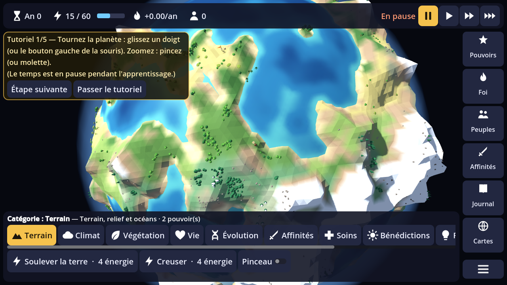
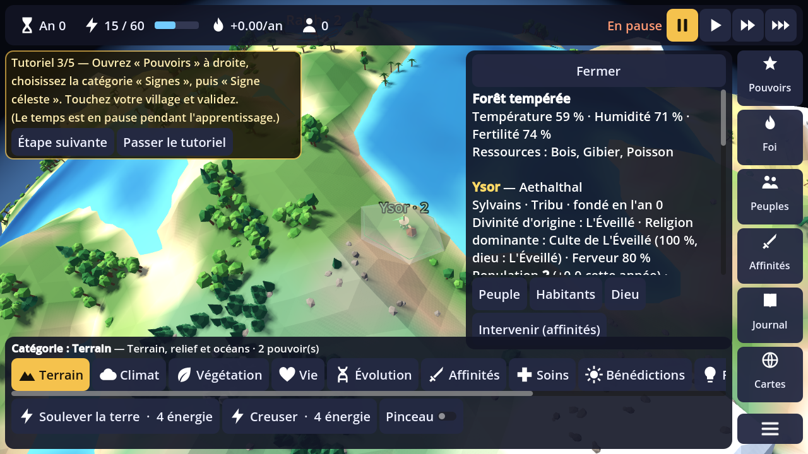
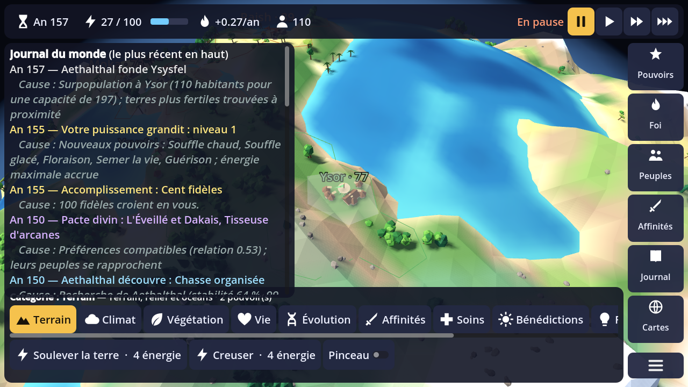
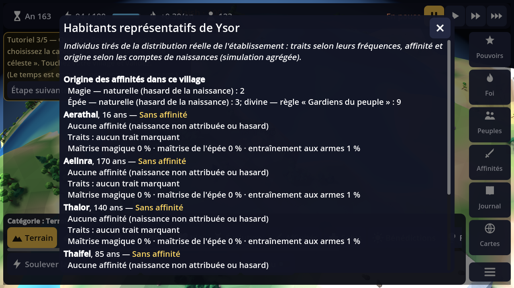
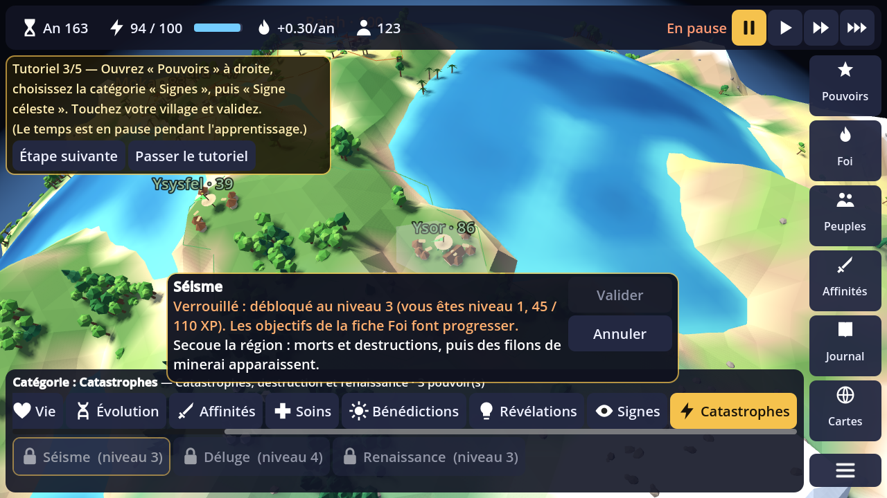
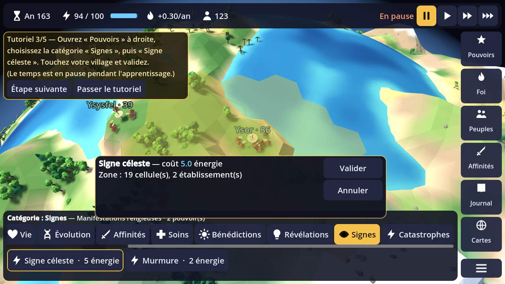
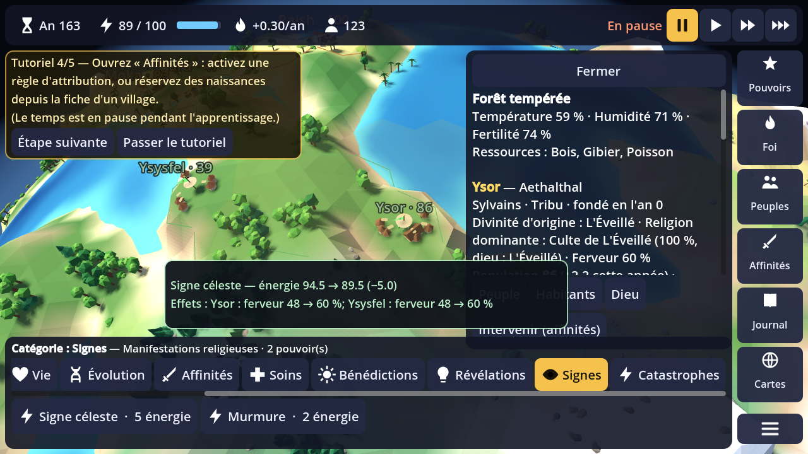
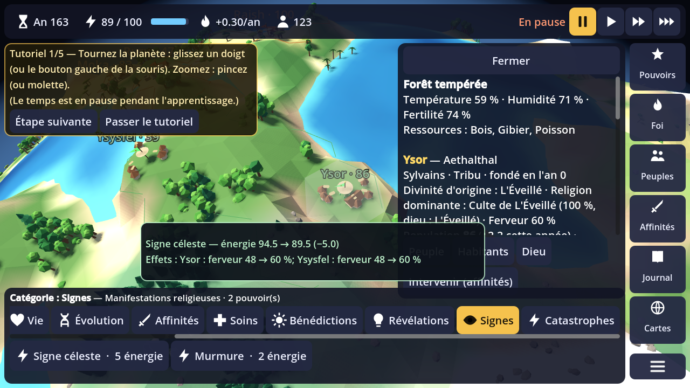

# Démonstration vérifiable — version 0.3.0

Séquence produite par `tests/interaction_demo.gd`. Le jeu y est piloté par de **vrais événements d'entrée** :
glisser et molette à la souris, glisser au doigt, clics sur les boutons de l'interface, toucher sur la planète.
Le script vérifie chaque étape et capture l'écran. Résultat : **47 vérifications réussies, 0 échec**.

```
xvfb-run godot --path . --rendering-method gl_compatibility -s tests/interaction_demo.gd -- <dossier>
```

Environnement réellement testé : Linux x86-64, Godot 4.4.1, rendu logiciel (llvmpipe, Xvfb), 1280×720,
souris et toucher simulés par `Input.parse_input_event`. **Aucun téléphone n'a été testé** : le comportement
tactile réel (précision du doigt, gestes à deux doigts, zone de sécurité) reste à confirmer sur Android.

## 1. Tutoriel


| Vérifié | Résultat |
|---|---|
| Le temps est en pause au début du tutoriel ; aucune année ne passe | ✔ |
| Glisser à la souris valide « tourner la planète » | ✔ |
| La molette zoome | ✔ (2,20 → 1,98) |
| Glisser au doigt valide la même étape | ✔ |
| « Passer le tutoriel » le termine et relance le temps | ✔ |
| « Revoir le tutoriel » (menu) le relance, temps en pause | ✔ |
| Toucher un village valide l'étape 2 ; utiliser un pouvoir l'étape 3 ; une règle l'étape 4 ; le journal l'étape 5 | ✔ (étapes 2 et 3 vérifiées par le script) |

**Cause du défaut signalé** : l'étape 1 n'avance que sur un geste réel ; les scripts de capture précédents n'en
envoyaient aucun, et le temps continuait de s'écouler. Le tutoriel est maintenant en pause jusqu'à sa fin ou
jusqu'à « Passer », avec un bouton « Étape suivante ».

À développer : surbrillance de l'élément d'interface visé par chaque étape.

## 2. Village sélectionné et sa fiche


Toucher la bannière (ou ses abords) ouvre la fiche. La sélection suit désormais le relief (rayon lancé jusqu'au
terrain) et s'accroche au village le plus proche. Contenu vérifié : nom, peuple, espèce, organisation, divinité
d'origine, religion dominante et ferveur, population et variation annuelle, capacité du milieu, ressources du
territoire, besoins (nourriture, espace, stabilité, foi), développement (époque, découvertes, voie), activité
(recherche en cours, croissance ou déclin, colonie en préparation, guerre), problèmes (états temporaires) et
dernier événement avec sa cause.

Repères : dans **Cartes**, les options « Noms des villages » (étiquettes aux couleurs du peuple, avec la
population) et « Frontières des peuples » (traits fins aux couleurs du peuple) s'activent indépendamment de la
carte thématique. Les bannières ont une forme propre à chaque espèce.

À développer : regroupement des étiquettes quand beaucoup de villages se chevauchent ; icônes de besoin
au-dessus des villages.

## 3. Activité autonome et son résultat


✔ Sans aucune intervention, le peuple du joueur fonde un second village en 157 ans, puis d'autres. Le journal
explique la cause (« Surpopulation à X (… habitants pour une capacité de …) ; terres plus fertiles trouvées à
proximité »). Ses découvertes sont aussi journalisées avec leur cause.

Correction d'équilibrage : chez les Sylvains (reproduction lente), la première colonie apparaissait après
environ 200 ans. Les colons partent maintenant dès que le village atteint 55 % de la capacité du milieu
(au lieu de 70 %).

À développer : rendre visible l'activité sur la carte (colons en route, chantiers).

## 4. Naissances, affinités et leur origine


| Règle | Vérification |
|---|---|
| 2/3 des naissances ouvertes à l'attribution divine, 1/3 naturelles | ✔ en jeu : 52 / 27 sur 6 ans ; ✔ test unitaire exact (2000 / 1000) |
| Aucune double affinité naturelle | ✔ en jeu et en test (50 000 tirages, même si la configuration la demande) |
| Sans attribution divine, la naissance reste sans affinité | ✔ en test ; en jeu, 30 naissances divines sans attribution (budget, autres dieux, non-croyants) |
| Une naissance reçoit l'affinité par une règle, avec explication | ✔ « Règle « Gardiens du peuple » : peuple d'origine » |

**Nouveau** : chaque établissement mémorise l'**origine** de ses porteurs d'affinité. Origines possibles :
naturelle, règle (avec son nom), ordre manuel, don tardif, création des fondateurs. Ces compteurs suivent les
naissances, les morts, les colons et les dons tardifs ; un test vérifie qu'ils restent égaux aux effectifs. La
fiche « Habitants » (depuis un village, ou depuis la fiche d'un peuple : « Habitants » pour chaque
établissement) affiche la répartition des origines du village. Pour chaque individu représentatif : âge,
traits, affinité, maîtrises, et origine de l'affinité (avec la règle appliquée).

Limite assumée : la simulation est agrégée, les individus sont des **représentants tirés des distributions
réelles**, pas des personnes suivies d'une année à l'autre.

## 5. Pouvoir : catégorie → pouvoir → cible → confirmation → effet
| | |
|---|---|
|  |  |



| Étape | Vérification |
|---|---|
| Les 11 catégories affichent chacune leurs propres pouvoirs et apparaissent sélectionnées | ✔ (clic réel sur chaque catégorie) |
| La catégorie active est nommée au-dessus des onglets et défile pour rester visible | ✔ |
| Un pouvoir verrouillé ou trop cher explique pourquoi (niveau, XP, énergie, délai estimé) | ✔ |
| Sélection du pouvoir → mode ciblage | ✔ |
| Toucher la planète → prévisualisation de la zone et du coût | ✔ |
| Validation → coût débité une seule fois | ✔ 94,5 → 89,5 ; une seconde validation ne débite rien |
| Effet réel sur la simulation | ✔ ferveur de Ysor 48 → 60 % (et du village voisin dans la zone) |
| Retour visuel | ✔ pulsation de la zone, bandeau « coût et effets mesurés avant/après », fiche du village touché mise à jour |

**Cause du défaut signalé** : la catégorie par défaut était « Signes », dont l'onglet sélectionné se trouvait
hors de l'écran, à droite. On voyait donc « Signe céleste » et « Murmure » sans comprendre pourquoi. La catégorie
par défaut est maintenant « Terrain », un en-tête nomme la catégorie active, et l'onglet défile pour rester
visible.

À développer : effet visuel propre à chaque pouvoir (pluie, aurore, séisme).

## 6. Sauvegarde rechargée


✔ Après sauvegarde, retour au menu et reprise, on retrouve : l'année et les 7 villages, l'effet du pouvoir
(ferveur 60 %), l'énergie (89,5), les statistiques de naissances et l'historique des attributions, ainsi que la
règle activée.

## Autres vérifications de cette version
- Tests de simulation : 30 tests, 349 assertions (nouveau : cohérence des origines d'affinité).
- Test de fumée de l'interface : parcours complet sans erreur.
